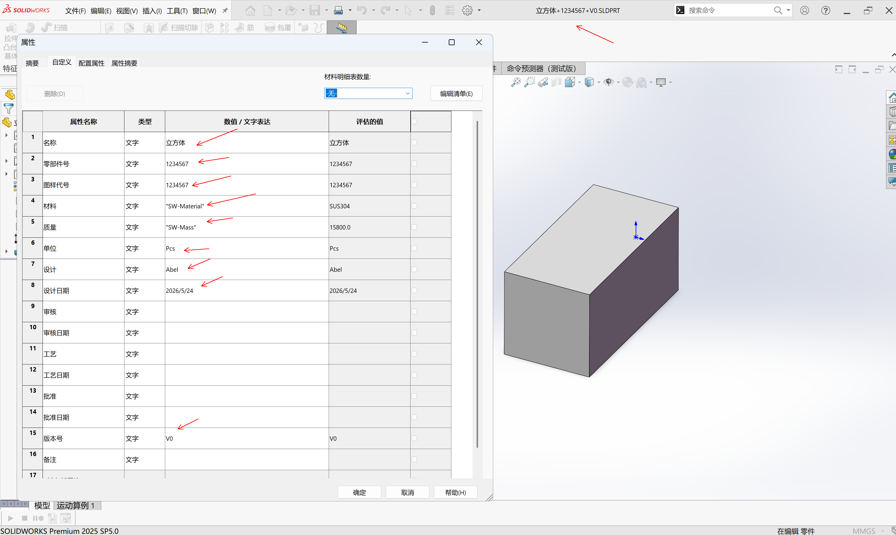
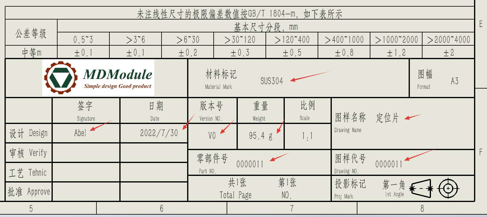

# SolidWorks 属性智能更新宏 · 批量版 (Batch Property Updater)

>  **SolidWorks 零件标准化工作流的一环**——选择一个工程文件夹，递归遍历所有 SW 文件，自动拆分文件名并批量填写 16 项标准自定义属性表，最后生成分类统计报告。
>
>  **本仓库为批量版**，如只需处理单个已打开文件，请见 [sw-property-updater](https://github.com/mdmodule/sw-property-updater)。





## 核心定位：批量文件夹 · 递归遍历 · 文件名拆分 → 属性填写

**单文件版**需要手动打开每个文件再运行宏；**批量版**直接选择一个文件夹，自动处理其中的所有 SW 文件（包括子文件夹）。

```
选择工程文件夹/
├── 底板+MDM-001+V1.0.sldprt    [OK] 格式规范 → 拆分填充
├── 侧板+MDM-002+V1.0.sldprt    [OK] 格式规范 → 拆分填充
├── 总成+MDM-000+V2.0.sldasm    [OK] 格式规范 → 拆分填充
├── 临时零件.sldprt              [!] 格式不符 → 填空白模板
└── 子装配/
    └── 支架+MDM-003+V1.1.sldprt [OK] 递归处理

         ↓ 处理完成
┌─────────────────────────────────────┐
│  处理报告                          │
│ 零件: 3 件  装配体: 1 件            │
│ 格式不符: 1 件 (临时零件)           │
└─────────────────────────────────────┘
```

## 与单文件版对比

| 特性 | 单文件版 | 批量版 |
|------|---------|--------|
| 处理方式 | 手动打开文件 → 运行宏 | 选择文件夹 → 自动递归 |
| 适用场景 | 零星修改、新建零件 | 项目初始化、批量标准化 |
| 递归子文件夹 | [X] | [OK] |
| 静默处理 | [X] 交互式 | [OK] 无弹窗 |
| 分类统计报告 | [X] | [OK] 零件/装配体/异常分类 |
| 链接容错 | [X] | [OK] 跳过外部参考搜索 |

## 功能特性

- **递归批量处理**：选择一个文件夹，自动遍历所有子文件夹中的 `.sldprt` 和 `.sldasm` 文件
- **静默执行**：自动抑制 SolidWorks 弹窗消息，过程中无需任何人工干预
- **智能文件名解析**：格式为 `名称+代号+版本` 时自动拆分填充；不合规则填空模板并单独标记
- **智能日期保留**：保留原有的"设计日期"，若不存在则自动填入当天日期
- **全量清理重建**：强制按 1-16 顺序重建标准属性表，确保一致性
- **零件/装配体自适应**：格式规范时，材料关联 `SW-Material@文件名`，质量关联 `SW-Mass@文件名`
- **链接丢失容错**：跳过外部参考和参考列表搜索，防止因链接丢失导致打开失败
- **分类统计报告**：处理完成后生成详细的分类汇总报告（成功零件/装配体数 + 格式异常清单）

## 属性表结构 (16项)

| 序号 | 属性名 | 填充方式 |
|------|--------|----------|
| 1 | 名称 | 文件名第1段 |
| 2 | 零部件号 | 文件名第2段 |
| 3 | 图样代号 | 文件名第2段 |
| 4 | 材料 | 格式规范: `SW-Material@文件名` / 否则: 空 |
| 5 | 质量 | `SW-Mass@文件名` |
| 6 | 单位 | `Pcs` |
| 7 | 设计 | `Abel` |
| 8 | 设计日期 | 保留原值或当日 |
| 9 | 审核 | 空白（流程占位） |
| 10 | 审核日期 | 空白（流程占位） |
| 11 | 工艺 | 空白（流程占位） |
| 12 | 工艺日期 | 空白（流程占位） |
| 13 | 批准 | 空白（流程占位） |
| 14 | 批准日期 | 空白（流程占位） |
| 15 | 版本号 | 文件名第3段 |
| 16 | 备注 | 空白 |

## 文件命名规范

```
零件名称+图样代号+版本号.sldprt
```

示例：`底板+MDM-001+V1.0.sldprt`

- [OK] `底板+MDM-001+V1.0` → 自动拆分识别，计入成功统计
- [!] `底板` → 填空白模板，计入异常统计

## 使用方法

1. 打开 SolidWorks（无需打开任何文件）
2. `工具` → `宏` → `运行`，选择 `PropertyUpdaterBatch.swp`
3. 在弹出的文件夹选择对话框中，选择需要处理的工程文件夹
4. 等待处理完成，查看统计报告

> [!] **警告**：批量处理会打开、修改并保存文件夹内所有 SW 文件！建议先备份或先在测试文件夹中试用。

## 环境要求

- SolidWorks 2025（理论上兼容 2020+）
- 启用宏的 SolidWorks 环境

## 下载与安装

**直接下载（推荐）**：[PropertyUpdaterBatch.swp](https://github.com/mdmodule/sw-property-updater-batch/releases/latest/download/PropertyUpdaterBatch.swp) —— 编译好的宏，48 KB

1. 下载 `PropertyUpdaterBatch.swp`
2. 打开 SolidWorks → `工具` → `宏` → `运行` → 选择它
3. 在文件夹对话框里选要处理的工程文件夹 → 等处理完成
4. 可选：添加到 SolidWorks 自定义工具栏

**想改代码**：下载 `PropertyUpdaterBatch.bas` → `工具` → `宏` → `新建` → 粘贴 → 另存为 `.swp`

全部版本见 [Releases](https://github.com/mdmodule/sw-property-updater-batch/releases)。

## 许可

MIT License - 随意使用和修改。

## 作者

机械工程师，借助 AI 辅助开发。
